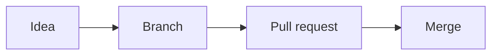

# Writing in Markdown

README files, issues, pull requests, comments, and wikis on GitHub all use **Markdown**, a simple way to format text with ordinary symbols. You type plain characters, and GitHub turns them into headings, bold text, lists, and links. Learning it takes about twenty minutes and pays off everywhere, including in AI chat tools, which use the same symbols.

:::summary In this chapter
- Headings, emphasis, lists, and links
- Images, tables, and code blocks
- GitHub extras: task lists, mentions, issue links, alerts, and collapsible sections
- A ready-to-use README skeleton you'll fill in later
:::

## The basics

```markdown
# Big heading
## Smaller heading
### Even smaller

**bold**, *italic*, ~~strikethrough~~, and `code`

- a bullet
- another bullet
  - an indented bullet (two spaces in)

1. a numbered step
2. another step

[a link](https://github.com)

> A quotation, shown with a bar down the side.
```

> [!TIP]
> In any GitHub text box you can select text and press <kbd>Ctrl</kbd> + <kbd>B</kbd> (<kbd>Cmd</kbd> + <kbd>B</kbd> on a Mac) for bold, or <kbd>Ctrl</kbd> + <kbd>I</kbd> for italic. Pasting a web address over selected text turns it into a link.

### Line breaks and paragraphs

Leave a blank line between paragraphs. A single line break inside a paragraph is usually joined up with the line before. To force a new line without a gap, end the line with a backslash `\` or two spaces.

## Images

```markdown

```

The text in square brackets is the **alt text**: a description read aloud by screen readers and shown if the image can't load. Always write one. In an issue or comment you can simply drag an image into the text box and GitHub uploads it and writes the Markdown for you.

## Tables

```markdown
| Day      | Opens | Closes |
|----------|-------|--------|
| Monday   | 8am   | 4pm    |
| Saturday | 9am   | 2pm    |
```

The second line, made of dashes, separates the header from the rows. The columns don't have to line up perfectly; neat spacing just makes the plain text easier to read.

## Code blocks

Wrap code in three backticks, and name the language after the first three for colored highlighting:

````markdown
```python
print("Hello, GitHub!")
```
````

## GitHub extras

GitHub adds a few features to standard Markdown, sometimes called **GitHub Flavored Markdown**.

| Write | You get |
|---|---|
| `- [ ] Buy flour` | A tick-box task list item |
| `- [x] Order boxes` | A ticked item |
| `@username` | A mention that notifies that person |
| `#12` | A link to issue or pull request number 12 |
| `:tada:` | An emoji (type `:` to see suggestions) |
| A bare web address | A clickable link |

### Alerts

Alerts are colored callout boxes, like the tips in this manual. Start a quote with one of five keywords:

```markdown
> [!NOTE]
> Useful background information.

> [!TIP]
> A helpful shortcut.

> [!IMPORTANT]
> Something people must know.

> [!WARNING]
> Something that needs care.

> [!CAUTION]
> A risky action to avoid.
```

### Collapsible sections and footnotes

```markdown
<details>
<summary>Click to see the full error log</summary>

The long text goes here, hidden until someone clicks.

</details>

Our hours change in winter.[^1]

[^1]: From November to February we close at 3pm.
```

### Diagrams

GitHub can draw simple flowcharts from text using **Mermaid**, a diagram language. Put the description in a code block labeled `mermaid`:

````markdown

````

## A README skeleton

Copy this into any new project's `README.md` and fill in the blanks. The next chapter explains what makes a README genuinely helpful.

```markdown title=README.md
# Project name

One sentence: what this is and who it's for.

## What it does

- Main feature one
- Main feature two

## How to use it

1. Step one
2. Step two

## Contributing

Ideas and fixes are welcome. Please open an issue first.

## License

MIT. See the LICENSE file.
```

```prompt
Turn these notes into a clear, friendly README.md for my GitHub
repository. Use headings for What it does, How to install,
How to use, and License. Keep it short and use plain English.
Notes: [paste your notes here]
```

:::checklist
- I can make headings, bold text, lists, and links
- I've added an image with alt text
- I've written a task list in an issue or README
- I've tried an alert box such as `> [!TIP]`
:::
